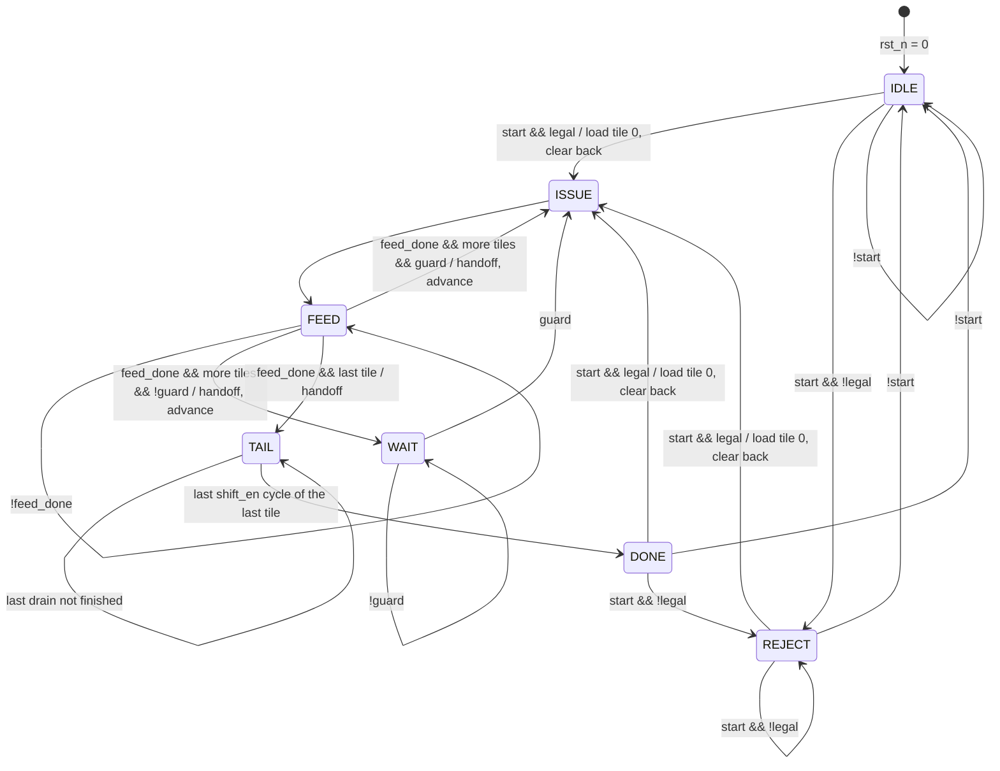

# `tile_ctrl` — control FSM contract (v2: drain/feed overlap)

Status: **implemented (v2)** in `rtl/tile_ctrl.sv`, with V1–V8 as recommended,
verified per §10: model pytest (55), cocotb lockstep + monitors + coverage
closure at n = 2, 3, 4, 5, 8 (16/16 each; at n = 5 also with `LOCKSTEP=0` and
with `SVA=0`), SVA, and a mutation campaign of 18 planted bugs, all caught. One
of them (the ISSUE guard using the current tile's dims instead of the next
one's) only changes behaviour at n ≤ 3, where FEED → ISSUE exists, and is caught
there in all four modes. A synchronous-reset mutant is invisible to the
assertions alone, by design (§11.17); every other mutant is caught by lockstep,
monitors and SVA independently. The system
test (`tb/matmul_top/`) passes at n = 2, 4, 5 with the collector on `cap_*`.
v1 (fully serialized tiles) is in git history (this file and
`rtl/tile_ctrl.sv` as of commit `9c07093`); what changed is collected in §0.

All timing is derived from the RTL as of commit `9c07093` (pe, pe_grid,
read_sequencer, skew_buffer, feeder, collector) and was cross-checked in
Phase 0 by running `FeederModel` → a grid of `PEModel`s → `CollectorModel`
under the v2 schedule and comparing C against numpy (§6.3). **No existing
module other than `tile_ctrl` changes.** `matmul_top` changes only its wiring
(§4.5).

---

## 0. Changes from v1

| | v1 | v2 |
|---|---|---|
| Tile period (full tiles, K ≥ 2) | K + 3n + 1 | **K + 2n − 2** (saves n + 3 per tile) |
| Next tile's ISSUE | after the previous tile's last DRAIN cycle | as soon as the schedule rule §6.2 allows, usually while the previous tile is still flushing |
| Structure | one FSM: ISSUE → FEED → FLUSH → CAPTURE → DRAIN | **front FSM** (ISSUE, FEED, WAIT, TAIL) plus a **back sequencer** (capture slot + drain) running concurrently |
| Which tile the collector is told about | `tile_m`, `tile_n`, `feed_M`, `feed_N` | **new outputs** `cap_tile_m`, `cap_tile_n`, `cap_M`, `cap_N` (§4.4). The feed-side outputs name the tile being fed, which at `capture` is often already the next one |
| Per-tile `capture` / `shift_en` timing | capture at τ = K + M_t + N_t + 1, then n − 1 shifts | **unchanged** (V2) |
| Single-tile job latency | K + M_t + N_t + n + 1 | **unchanged** |
| Multi-tile job latency L | closed form | sum of per-transition gaps (§6.2) |
| Captures | n + K + M_t' + N_t' + 1 apart | **≥ n + 1 apart** (V3), so the collector never sees a capture mid-drain |
| `busy`, `done`, `error`, command rules, illegal inputs | | **unchanged** |

Measured gain (§6.3): 27–40% fewer cycles for K ≤ n on 16×16 and 64×64 jobs,
8.5% at n = 4, K = 64.

## 1. Scope

`tile_ctrl` sequences one matmul job `C[M×N] = A[M×K] · B[K×N]` over a square
`ARRAY_DIM × ARRAY_DIM` grid by tiling the output. It emits **control signals
only**:

- when the feeder starts a tile, and with which per-tile dims;
- which output tile is being fed (a tile *identifier*, not an address);
- when the grid captures accumulators into the shadow registers, when it shifts
  them out, and which tile that capture belongs to.

It never touches operand or result data, never computes memory addresses and
never generates `valid` / `first` bits.

### What it deliberately does **not** own (already owned upstream)

| Concern | Owner |
|---|---|
| k loop counter, `rd_en`, `rd_col_a` / `rd_row_b` (= k) | `read_sequencer` |
| 1-cycle operand-buffer latency alignment | `read_sequencer` |
| Per-lane `valid` (lane < M, lane < N): edge-tile inactivity | `read_sequencer` |
| `first` on k = 0 (clears the accumulators, no extra cycle) | `read_sequencer` → rides with A payload → `pe` |
| Operand skew | `skew_buffer` |
| Multiply-accumulate, hold on `in_valid = 0` | `pe` |
| Placing drained rows in C | `collector` |

Because accumulator clearing is done by `first`, there is **no CLEAR/INIT
state**. Because the k loop lives in `read_sequencer`, the FSM learns that the
feed has ended from `feed_done` rather than by counting K itself.

**Why overlap is possible at all.** `pe_grid` already double-buffers the
result: `capture` copies every accumulator into its shadow register in one
cycle, and the drain shifts the shadow registers while the accumulators are
free. The next tile's `first` payload overwrites an accumulator only when it
arrives, so the next tile's feed can start before the previous tile is
captured, as long as the capture happens before the first overwrite (§6.2).

## 2. Tiling decision

Unchanged from v1. Tiling is over **M and N only**. Each output tile is
`M_t × N_t` with `M_t = min(n, M − tile_m·n)` and `N_t = min(n, N − tile_n·n)`.
K streams through every tile in full (`1 ≤ K ≤ MAX_K`); K-tiling needs an
upstream change (`read_sequencer` always asserts `first` on k = 0), see §11.

Tile order is **row-major over tiles**: `tile_n` is the inner loop and `tile_m`
the outer loop.

## 3. Parameters, clocking, reset

| Name | Source | Default | Meaning |
|---|---|---|---|
| `ARRAY_DIM` (n) | `pe_pkg` | 4 (Makefiles use 5) | Grid is n × n. **Must be ≥ 2** |
| `MAX_K` | `pe_pkg` | 1024 | Largest legal K |
| `K_W` | `pe_pkg` | `$clog2(MAX_K+1)` | Width of K |
| `DIM_W` | `pe_pkg` | `$clog2(n+1)` | Width of per-tile dims (feeder M/N) |
| `MAX_M` | `tile_ctrl` module parameter | 64 | Largest legal job M |
| `MAX_N` | `tile_ctrl` module parameter | 64 | Largest legal job N |
| `M_W` | localparam | `$clog2(MAX_M+1)` | Width of job M |
| `N_W` | localparam | `$clog2(MAX_N+1)` | Width of job N |
| `TILES_M` | localparam | `ceil(MAX_M / n)` | Max tile rows |
| `TILES_N` | localparam | `ceil(MAX_N / n)` | Max tile cols |
| `TM_W` / `TN_W` | localparam | `max(1, $clog2(TILES_M))` / same for N | Tile-index widths |

`MAX_M` / `MAX_N` are module parameters (set with `-G`), not `pe_pkg` defines,
so `pe_pkg.sv` stays untouched (Q2). The defaults are deliberately **not** of
the form 2^x − 1, so out-of-range dims are representable on the ports.

- Single clock `clk`, all state updates on `posedge clk`.
- `rst_n`: **asynchronous, active-low**, matching `pe` and `read_sequencer`.
- Reset state: front FSM in `IDLE`, back sequencer empty, every output 0.

## 4. Port list

Timing notation: "post-edge e" means the value visible after rising edge e.
"Sampled at edge e" means the value the receiver registers on edge e.

### 4.1 Command interface (unchanged)

| Port | Dir | Width | Timing / contract |
|---|---|---|---|
| `clk` | in | 1 | |
| `rst_n` | in | 1 | async, active-low |
| `start` | in | 1 | Sampled on an edge where `busy = 0` (front in IDLE, DONE or REJECT). **Ignored while `busy = 1`** |
| `M` | in | `M_W` | Sampled only on an accepted `start` edge |
| `N` | in | `N_W` | as `M` |
| `K` | in | `K_W` | as `M` |
| `busy` | out | 1 | High from the cycle after an accepted legal `start` through the cycle before `done` |
| `done` | out | 1 | **Single-cycle pulse**, with `busy = 0`. Exactly one per accepted `start`, legal or illegal. For a legal job it is the last tile's row-0 drain cycle, so all of C is written by the end of it (`collector_contract.md` §5.3) |
| `error` | out | 1 | High only together with `done`. `done & error` = command rejected, no tiles run |

### 4.2 Toward the feeder (`rtl/feeder.sv`)

| Port | Dir | Width | Drives / driven by | Timing / contract |
|---|---|---|---|---|
| `feed_start` | out | 1 | → `feeder.start` | 1-cycle pulse, once per tile, only in ISSUE. The feeder is always idle then (§6.2, term a) |
| `feed_M` | out | `DIM_W` | → `feeder.M` | M_t of the tile being fed, ∈ [1, n]. Stability rule §4.6 |
| `feed_N` | out | `DIM_W` | → `feeder.N` | N_t of the tile being fed, ∈ [1, n] |
| `feed_K` | out | `K_W` | → `feeder.K` | Job K ∈ [1, MAX_K], constant for the whole job |
| `feed_done` | in | 1 | ← `feeder.done` | Expected only in FEED. Ignored in every other front state |

`feeder.busy` is still not consumed: the schedule guarantees the feeder is idle
at every ISSUE, and `feed_done` is enough.

### 4.3 Toward `pe_grid` (`rtl/pe_grid.sv`)

| Port | Dir | Width | Drives | Timing / contract |
|---|---|---|---|---|
| `capture` | out | 1 | → `pe_grid.capture`, `collector.capture` | 1-cycle pulse, once per tile, exactly K + M_t + N_t + 1 cycles after that tile's `feed_start` |
| `shift_en` | out | 1 | → `pe_grid.shift_en`, `collector.shift_en` | High for exactly the n − 1 cycles after each `capture`, and at no other time. Never high together with `capture` |

### 4.4 Tile identifiers

| Port | Dir | Width | Consumer | Timing / contract |
|---|---|---|---|---|
| `tile_m` | out | `TM_W` | operand buffer (A address) | Tile row of the tile **being fed** (or about to be fed, in WAIT). ∈ [0, ceil(M/n) − 1] |
| `tile_n` | out | `TN_W` | operand buffer (B address) | Tile column of the tile being fed. ∈ [0, ceil(N/n) − 1] |
| `cap_tile_m` | out | `TM_W` | `collector.tile_m` | **New in v2.** Tile row of the tile in the capture slot: at every `capture`, the tile that capture belongs to |
| `cap_tile_n` | out | `TN_W` | `collector.tile_n` | **New.** Same, tile column |
| `cap_M` | out | `DIM_W` | `collector.tile_rows` | **New.** Same, M_t |
| `cap_N` | out | `DIM_W` | `collector.tile_cols` | **New.** Same, N_t |

These are identifiers, not addresses. The operand buffer serves
`A[tile_m·n + lane][k]` and `B[k][tile_n·n + lane]`; it only reads them while
the feeder has `rd_en` high (FEED), and they are stable then.

### 4.5 System wiring change (`rtl/matmul_top.sv`)

The collector's four tile inputs move from `tile_m`, `tile_n`, `feed_M`,
`feed_N` to `cap_tile_m`, `cap_tile_n`, `cap_M`, `cap_N`. Nothing else in the
top changes. `collector.sv` itself is unchanged (V3, V4).

### 4.6 Output-register stability rule

- `feed_M`, `feed_N`, `feed_K`, `tile_m`, `tile_n` change on **only two edges**:
  an accepted legal `start` (load tile 0), and the **handoff edge** that ends a
  tile's `feed_done` cycle **when another tile follows** (advance to the next
  tile). They do not change on the last tile's handoff, on DONE or on REJECT.
- `cap_tile_m`, `cap_tile_n`, `cap_M`, `cap_N` change on **only** the handoff
  edge (every tile, the last one included): they take the values the feed-side
  outputs had in the `feed_done` cycle.
- Both groups reset to 0 and are otherwise held, including while idle, so the
  lockstep compare checks them every cycle.

## 5. Structure

Two cooperating sequencers in one module. They share no counters; they meet
at the **handoff edge** (the edge that ends a tile's `feed_done` cycle) and in
the ISSUE guard.

### 5.1 Front FSM (owns the command interface and the feed)

| State | busy | done | error | feed_start | Leaves when |
|---|:-:|:-:|:-:|:-:|---|
| IDLE | 0 | 0 | 0 | 0 | `start` |
| ISSUE | 1 | 0 | 0 | **1** | always (1 cycle) |
| FEED | 1 | 0 | 0 | 0 | `feed_done` (handoff) |
| WAIT | 1 | 0 | 0 | 0 | the ISSUE guard (§6.2) allows the next tile |
| TAIL | 1 | 0 | 0 | 0 | the last tile's last `shift_en` cycle |
| DONE | 0 | **1** | 0 | 0 | always (1 cycle), behaves like IDLE on `start` |
| REJECT | 0 | **1** | **1** | 0 | always (1 cycle), behaves like IDLE on `start` |

`legal = (1 ≤ M ≤ MAX_M) && (1 ≤ N ≤ MAX_N) && (1 ≤ K ≤ MAX_K)`



`busy` = front ∈ {ISSUE, FEED, WAIT, TAIL}. The earliest next ISSUE cycle is
the cycle after the `feed_done` cycle (FEED → ISSUE directly, WAIT skipped) (V7). "guard" in a FEED or WAIT cycle means the
**next** cycle is the next tile's ISSUE cycle per §6.2.

**Tile advance** (on the handoff edge, when more tiles follow). Same compare
logic as v1, with `m_rem`, `n_rem` = rows/cols remaining including the current
tile:

```
M_t = (m_rem > n) ? n : m_rem          N_t = (n_rem > n) ? n : n_rem
if (n_rem > n)      { tile_n++; n_rem -= n; }                          // more tiles
else if (m_rem > n) { tile_m++; m_rem -= n; tile_n = 0; n_rem = N_h; } // more tiles
else                                                                   // last tile
```

On load (accepted legal `start`): `tile_m = tile_n = 0`, `m_rem = M`,
`n_rem = N`, `N_h = N`, `K_h = K`.

**Illegal state encodings.** 7 front states in 3 bits leave one unused code.
The `default` branch goes to IDLE with every output at its default.

### 5.2 Back sequencer (owns `capture`, `shift_en`, `cap_*`)

- **Capture slot**: holds at most one tile. On the handoff edge it is loaded
  with the tile whose feed just ended (`cap_*` ← feed-side values). It pulses
  `capture` for that tile in the cycle K + M_t + N_t + 1 after the tile's ISSUE,
  which is M_t + N_t − 1 cycles after the handoff edge, then is empty. The
  schedule (§6.2, term b) guarantees the slot is empty, or captures in that
  same cycle, whenever a handoff edge arrives.
- **Drain**: after each `capture`, `shift_en` for exactly n − 1 cycles. The
  schedule (§6.2, term c) guarantees the next `capture` comes at least one
  cycle after the last of those shifts.
- The back sequencer is **cleared on every accepted legal start** and its
  `capture` / `shift_en` are **gated by `busy`**, so a corrupted back register
  can never pulse the grid while the FSM is idle.

The counter encoding is an implementation detail. The contract is the cycle on
which each pulse happens.

## 6. Cycle-accurate timing

### 6.1 One tile

Tile-relative cycle τ: τ = 0 is the tile's ISSUE cycle, and the feeder samples
`start` on the edge into τ = 1. The per-tile `capture` and `shift_en` timing is
**exactly v1's**.

| τ | front | back / outputs | Feeder / grid |
|---|---|---|---|
| 0 | ISSUE | `feed_start` | |
| 1 … K | FEED | | feeder `busy`, `rd_en`. Payload k leaves feeder lane i at τ = k + 3 + i |
| K + 1 | FEED | | feeder `done`. **Handoff edge at the end of this cycle**: `cap_*` ← this tile; feed side advances |
| K + 2 … K + M_t + N_t | WAIT / next ISSUE / next FEED, or TAIL | tile waits in the capture slot | last payloads still crossing skew buffer and grid |
| K + M_t + N_t + 1 = τ_c | (any) | `capture` | **PE(M_t−1, N_t−1) becomes final in exactly this cycle**; zero slack |
| τ_c + 1 … τ_c + n − 1 | (any) | `shift_en` | `drain_out` shows grid row n − 1 − r at τ_c + 1 + r |
| τ_c + n | DONE if last tile | | `drain_out` shows row 0; the collector writes it this cycle |

Why τ_c: PE(i, j) does its k-th MAC on the edge into τ = k + 4 + i + j, so its
accumulator is final from τ = K + 3 + i + j. The last active PE is final at
τ = K + M_t + N_t + 1. Earlier captures a stale value (checked, §6.3).

**Single-tile job**: ISSUE, FEED (K + 1 cycles), TAIL, DONE at
τ = K + M_t + N_t + n + 1. Identical to v1.

### 6.2 Multi-tile job: the schedule rule

Let tile i have dims M_t × N_t and ISSUE cycle s_i; tile i + 1 has dims
M_t' × N_t'. Tile i + 1's ISSUE is **exactly**

```
s_{i+1} = s_i + G_i

G_i = max( K + 2,                                  (a) feeder free, ISSUE after the feed_done cycle
           M_t + N_t + max(K − 2, 0),              (b) tile i captured in time
           n + 1 + (M_t + N_t) − (M_t' + N_t') )   (c) captures n + 1 apart
```

and is never earlier. Each term:

- **(a)** The feeder is free from its `done` cycle (τ = K + 1). v2 issues from
  a separate ISSUE cycle, so the earliest is τ = K + 2 (V7). `feeder.busy` is
  therefore always low at `feed_start`.
- **(b)** Two limits on how far tile i's capture c_i = s_i + K + M_t + N_t + 1
  may trail the next ISSUE:
  1. **Overwrite.** Tile i + 1's first payload overwrites PE(0,0)'s
     accumulator on the edge into τ' = 4 of tile i + 1. So c_i ≤ s_{i+1} + 3.
  2. **One-tile capture slot.** Tile i + 1's handoff edge ends its `feed_done`
     cycle s_{i+1} + K + 1. So c_i ≤ s_{i+1} + K + 1, which is tighter only for
     K = 1.
  Together: c_i − s_{i+1} ≤ min(3, K + 1), which gives the term.
- **(c)** Tile i + 1's capture must come at least n + 1 cycles after tile i's,
  so that tile i's n − 1 shifts and its row-0 cycle are over (V3):
  c_{i+1} − c_i ≥ n + 1.

Only the per-transition max matters. In practice (b) binds within a tile row,
and (c) binds when tiles shrink (row end, last row) and K is small. (a) only
binds for tiny tiles, M_t + N_t ≤ 4 (n = 2, or edge tiles).

**Full tiles in a row**, n ≥ 2: G = K + 2n − 2 for K ≥ 2, and 2n for K = 1.
v1 was K + 3n + 1.

**Job latency.** Job-relative cycle t: t = 0 is tile 0's ISSUE (the cycle
after the accepted `start` edge). With tiles 0 … T − 1 in row-major order,
T = T_m · T_n:

```
L = Σ_{i=0}^{T−2} G_i  +  (K + M_t + N_t + n + 1) of the last tile
```

- `busy` is high for t = 0 … L − 1; `done` is high at t = L.
- The earliest next `start` is driven during t = L and sampled at the end of it.
- A rejected command gives `done & error` at t = 0, and `busy` never rises.
- There is no simple closed form, because G_i depends on the max of three
  terms. Phase 2's pure `tile_schedule()` computes it straight from this rule,
  independently of the state machine.

**Worked example** (n = 4, M = 6, N = 5, K = 3; v1 L = 54):

| tile (m, n) | M_t × N_t | ISSUE s_i | `feed_done` | `capture` c_i | shifts | row 0 | G_i = max(a, b, c) |
|---|---|---|---|---|---|---|---|
| (0, 0) | 4 × 4 | 0 | 4 | 12 | 13–15 | 16 | max(5, **9**, 8) = 9 |
| (0, 1) | 4 × 1 | 9 | 13 | 18 | 19–21 | 22 | max(5, **6**, 4) = 6 |
| (1, 0) | 2 × 4 | 15 | 19 | 25 | 26–28 | 29 | max(5, 7, **8**) = 8 |
| (1, 1) | 2 × 1 | 23 | 27 | 30 | 31–33 | 34 | — |

L = 23 + (3 + 2 + 1 + 4 + 1) = **34**: `done` at t = 34.

```
t          0  1  2  3  4  5  6  7  8  9 10 11 12 13 14 15 16 17
front     IS FD FD FD FD WT WT WT WT IS FD FD FD FD WT IS FD FD
feed_st    1  .  .  .  .  .  .  .  .  1  .  .  .  .  .  1  .  .
feed_dn    .  .  .  .  1  .  .  .  .  .  .  .  .  1  .  .  .  .
tile_m/n  00 00 00 00 00 01 01 01 01 01 01 01 01 01 10 10 10 10
cap_tile   ·  ·  ·  ·  · 00 00 00 00 00 00 00 00 00 01 01 01 01
capture    .  .  .  .  .  .  .  .  .  .  .  .  1  .  .  .  .  .
shift_en   .  .  .  .  .  .  .  .  .  .  .  .  .  1  1  1  .  .
drain_out  -  -  -  -  -  -  -  -  -  -  -  -  -  3  2  1  0  -

t         18 19 20 21 22 23 24 25 26 27 28 29 30 31 32 33 34
front     FD FD WT WT WT IS FD FD FD FD TL TL TL TL TL TL DN
feed_st    .  .  .  .  .  1  .  .  .  .  .  .  .  .  .  .  .
feed_dn    .  1  .  .  .  .  .  .  .  1  .  .  .  .  .  .  .
tile_m/n  10 10 11 11 11 11 11 11 11 11 11 11 11 11 11 11 11
cap_tile  01 01 10 10 10 10 10 10 10 10 11 11 11 11 11 11 11
capture    1  .  .  .  .  .  .  1  .  .  .  .  1  .  .  .  .
shift_en   .  1  1  1  .  .  .  .  1  1  1  .  .  1  1  1  .
drain_out  -  3  2  1  0  -  -  -  3  2  1  0  -  3  2  1  0
```

(`cap_tile` before the first handoff holds its previous value. `drain_out` shows
the grid row number while a drain is in progress.) At t = 12 the feed side
already names tile (0, 1); the collector gets (0, 0) from `cap_*`. That is the
v1 hazard that the new outputs remove.

### 6.3 Evidence (Phase 0 / Phase 1 probe)

A scratch probe drove `FeederModel` → `PEGridModel` → `CollectorModel` under
this exact schedule, with operands drawn from nonzero values (a zero operand
can hide a stale capture), and compared C with numpy:

- **Correct**: n ∈ {2, 3, 4, 5}, K ∈ {1, 2, 3, 4, 7, 12}, all M, N ∈ [1, 2n + 1].
  Every C element written once; last write in the `done` cycle. At every
  handoff the capture slot was empty or capturing; at every ISSUE the feeder was
  idle; captures were always ≥ n + 1 apart.
- **The physical bounds are tight** (Phase 0, ideal rule max(K + 1,
  K + M_t + N_t − 2, n + 1 + …)): capturing one cycle early fails in every
  job, and shaving one cycle off a gap where the overwrite or spacing term was
  the only binding one broke C (1,505 of 1,505 and 187 of 187 cases). v2's
  extra cycles in (a), (b) at K = 1 and (c) are deliberate (V3, V6, V7).
- **Cost of the implementable rule** versus the Phase 0 ideal
  (max(K + 1, K + M_t + N_t − 2, c)): identical for K ≥ 2; one cycle per
  (b)-bound transition for K = 1 (the capture slot); +0.66% summed over the
  sweep.

| n | K | M × N | v1 L | v2 L |
|---|---|---|---|---|
| 4 | 1 | 16 × 16 | 224 | 134 |
| 4 | 4 | 16 × 16 | 272 | 167 |
| 4 | 16 | 16 × 16 | 464 | 359 |
| 4 | 64 | 16 × 16 | 1232 | 1127 |
| 8 | 8 | 64 × 64 | 2112 | 1419 |
| 16 | 16 | 64 × 64 | 1040 | 755 |

## 7. Partial edge tiles

Unchanged from v1 in substance. The FSM puts `M_t` / `N_t` on `feed_M` /
`feed_N`; `read_sequencer` drives `valid = 0` on A lanes ≥ M_t and B lanes
≥ N_t, so PE(i, j) with i ≥ M_t or j ≥ N_t never MACs and **holds** a stale
accumulator from an earlier tile. The collector masks to M_t × N_t using
`cap_M` / `cap_N`.

- Each tile's flush (handoff to capture) is M_t + N_t − 1 cycles, so edge tiles
  capture sooner.
- The drain is always n − 1 shifts (bottom-up drain, active rows at the top).
- Shrinking tiles are where term (c) binds: a small tile's early capture must
  still wait for the previous full tile's drain.

## 8. Illegal and degenerate inputs

| Situation | Behaviour |
|---|---|
| `start` with M = 0, N = 0 or K = 0 | REJECT: `done & error` for one cycle, no feeder activity, `busy` stays 0. (K = 0 must never reach the feeder: `read_sequencer` would hang) |
| `start` with M > MAX_M, N > MAX_N or K > MAX_K | REJECT, same as above |
| `start` while `busy` | Ignored silently; in-flight job unaffected, M/N/K not sampled |
| `start` held high | One job per edge on which `busy = 0`. A `start` still high in DONE launches a new job |
| `start` in DONE or REJECT | Accepted like IDLE |
| `feed_done` outside FEED | Ignored (flagged by the system observer) |
| `rst_n` low mid-job | Asynchronously back to IDLE, back sequencer empty, every output 0, job abandoned, no `done` |
| M ≤ n and N ≤ n | Single tile, same path (FEED → TAIL), same latency as v1 |

Between jobs nothing extra is needed. The previous job's last capture c is
followed by DONE at c + n, so the new job's first ISSUE is at c + n + 1 or
later: after the capture (no overwrite risk), and its first capture is at
c + n + 1 + K + M_t + N_t + 1 ≥ c + n + 5, comfortably ≥ n + 1 after c.
Property 6c spans jobs to check this.

## 9. Properties (spec for the Phase 3 monitors and Phase 5 SVA)

1. `busy == (front ∈ {ISSUE, FEED, WAIT, TAIL})`.
2. Every accepted `start` produces exactly one `done` cycle, never with `busy`. Two consecutive `done` cycles only when the second answers a new command sampled in the first.
3. `error → done`.
4. `feed_start`, `capture` and `shift_en` are 0 whenever `busy = 0`. `capture & shift_en` is never true.
5. Per job: `feed_start` count = `capture` count = T_m·T_n; `shift_en` cycles = T_m·T_n·(n − 1).
6. Timing:
   - (a) per tile, `capture` exactly K + M_t + N_t + 1 cycles after its `feed_start` (the k-th capture of a job belongs to the k-th issued tile);
   - (b) `shift_en` high exactly in the n − 1 cycles after each `capture`;
   - (c) consecutive captures ≥ n + 1 cycles apart (also across jobs);
   - (d) the next `feed_start` exactly G_i cycles after this one (§6.2), and `done` exactly n cycles after the last `capture`;
   - (e) `feed_start` is never in a cycle where the feeder is busy or in its `done` cycle (model / system).
7. `tile_m < ceil(M/n)`, `tile_n < ceil(N/n)` while busy. Tiles are fed row-major, each exactly once.
8. At every `feed_start`: `feed_M = min(n, M − tile_m·n)`, `feed_N = min(n, N − tile_n·n)`, both ∈ [1, n]; `feed_K = K`.
9. **New:** at every `capture`, (`cap_tile_m`, `cap_tile_n`, `cap_M`, `cap_N`) equal (`tile_m`, `tile_n`, `feed_M`, `feed_N`) as they were at the matching tile's `feed_start`.
10. Stability: the feed-side and `cap_*` outputs change only on the edges in §4.6.
11. Job latency (accepted `start` edge → `done`) = L from §6.2. Rejected commands have latency 1.
12. `feed_done` is observed only in FEED (system only).

## 10. Files

| File | Phase | v2 work |
|---|---|---|
| `docs/fsm_contract.md` (this file) | 1 | rewritten as v2 |
| `tb/tile_ctrl/tile_ctrl_model.py`: `TileCtrlModel`, `tile_schedule()`, `job_latency()` | 2 | v2 model; `tile_schedule` from §6.2 directly; `job_latency` keeps its name and signature, so `tb/matmul_top` and `tb/host_if` pick up the new L |
| `tb/tile_ctrl/test_tile_ctrl_model.py` | 2 | v2 checks, including the grid + collector closed loop of §6.3 |
| `tb/tile_ctrl/test_tile_ctrl.py`, `Makefile` | 3 | v2 scoreboards, monitors for §9.6 and §9.9, coverage of each binding term (a), (b), (c) |
| `rtl/tile_ctrl.sv` | 3 (stub) → 4 | v2 |
| `rtl/matmul_top.sv` | 4 | collector rewired to `cap_*` (§4.5) |
| `tb/matmul_top/` | 5 | re-run; expected latency comes from `job_latency` |
| `docs/collector_contract.md` (§1, §3.1 sources, §5.1–5.3, §6), `docs/memory_contract.md` §5, `docs/top_contract.md` status, `README.md` | 5 | collector inputs from `cap_*`, v2 timing |

## 11. Known simplifications

1. **No K-tiling.** K ≤ MAX_K streams through each tile in one pass (§2).
2. **Overlap is limited by the broadcast `capture`.** All PEs capture in one cycle, so tile i must wait for its far corner PE(M_t−1, N_t−1) while the next tile overwrites PE(0,0) three cycles after its ISSUE: the period is ≥ K + M_t + N_t − 2. A capture that ripples through the grid with the data wave would bring it near K + 1, but it changes `pe` / `pe_grid` (out of scope; reported, not proposed). The feeder idles about M_t + N_t − 3 cycles per tile.
3. **`capture` is never delayed (V2).** The next ISSUE waits instead. Letting capture slip later gave the same total cycles in the Phase 0 sweep and would lose the exact, assertable capture cycle.
4. **Captures ≥ n + 1 apart, not n (V3).** n is physically enough (capture in the row-0 cycle), but the collector's contract forbids a capture mid-drain. Cost: 0.44% over the Phase 0 sweep, zero on jobs of full tiles.
5. **ISSUE is its own cycle, after the `feed_done` cycle (V7).** The feeder could accept a start in its `done` cycle; issuing there would need a Mealy `feed_start`. Costs one cycle only where term (a) is the sole max (M_t + N_t ≤ 4).
6. **One-tile capture slot (V6).** Costs one cycle per (b)-bound transition when K = 1 (§6.2 b.2).
7. **No valid/ready handshake**, no backpressure, no stall: the operand buffer always answers in one cycle and the collector is always ready.
8. **No operand double buffering / reuse**: each A row-tile is re-read T_n times and each B column-tile T_m times.
9. **Square grid only.**
10. **DRAIN is always n − 1 shifts**, even for edge tiles.
11. **Stale data outside M_t × N_t on `drain_out`**; masking is the collector's job (§7).
12. **No watchdog on `feed_done`.** If the feeder never reports done, the FSM waits in FEED until reset.
13. **`error` is a pulse** with no cause code (the host interface makes it sticky).
14. **`ARRAY_DIM ≥ 2` and `MAX_M, MAX_N ≥ ARRAY_DIM`**, enforced by elaboration-time `$error`.
15. **`MAX_M` / `MAX_N` are module parameters**, not `pe_pkg` defines.
16. **The cocotb suite covers part of the parameter space**: it needs `MAX_M, MAX_N ≥ 3·ARRAY_DIM + 1` and `MAX_K ≥ ARRAY_DIM + 1`, and refuses smaller limits with a clear message (as v1).
17. **The RTL assertions do not cover reset or X.** They are gated by an async-reset `sva_armed` flop; async-reset behaviour is checked by the cocotb monitors. §9.6e (feeder idle at `feed_start`) is checked by the cocotb feeder stand-in, §9.12 by the system observer in `tb/matmul_top/`. The timing assertions use checker-only counters (cycles since a `feed_start` / `capture`, ages carried through the handoff), not the design's `slot_cnt` / `drain` / `gap`, so a wrong design counter cannot satisfy its own check.
18. **The system test drives the product top through a Python host** (`tb/matmul_top/`, `docs/top_contract.md`).
19. **Some coverage only exists at small n.** FEED → ISSUE directly and term (a) binding need a tile with a successor and M_t + N_t ≤ 4, which only exists for n ≤ 3; WAIT lasting more than one cycle needs n ≥ 3. The testbench derives its required transitions and gap terms from the §6.2 schedule for the n it runs at, and the regression runs n = 2, 3, 4, 5, 8.

## 12. Decisions

Approved at the Phase 0 gate:

| # | Decision |
|---|---|
| V1 | Replace v1 in place; no OVERLAP parameter. v1 stays in git history |
| V2 | Per-tile `capture` cycle unchanged (K + M_t + N_t + 1 after ISSUE); the next ISSUE waits instead |
| V3 | Captures ≥ n + 1 apart, so `collector.sv` and its assertions stay unchanged |
| V4 | New outputs `cap_tile_m`, `cap_tile_n`, `cap_M`, `cap_N` feed the collector; the feed-side outputs keep driving operand addresses |
| V5 | This document is updated in place; L is a per-transition sum computed by `tile_schedule()` |

New in Phase 1, approved at the Phase 2 gate:

| # | Decision | Alternative considered |
|---|---|---|
| V6 | **Handoff at the end of the `feed_done` cycle**: the tile moves to the capture slot and the feed side advances to the next tile on that edge, so `tile_m`/`tile_n`/`feed_*` name the next tile during WAIT. Cost: one cycle per (b)-bound transition at K = 1 | Hand off at the next ISSUE: no K = 1 cost, but a tile could then be captured from either slot (front or back), and at n = 2 the next-but-one ISSUE can coincide with a capture, needing a third slot |
| V7 | **ISSUE is a Moore state** after the `feed_done` cycle (term a = K + 2) | Mealy `feed_start` in the `feed_done` cycle: saves a cycle only for tiles with M_t + N_t ≤ 3 |
| V8 | **Back sequencer cleared on every accepted start and its pulses gated by `busy`** | Rely on it draining naturally: cheaper, but a corrupted back register could pulse the grid while idle |

## 13. Open questions (deferred)

- **Q1. Overlap.** *Resolved by v2* (this document).
- **Q2. Parameter home.** Move `MAX_M` / `MAX_N` into `pe_pkg` once modifying the package is acceptable?
- **Q3. Collector interface.** *Resolved* by `docs/collector_contract.md`; v2 adds the `cap_*` outputs (V4) and leaves the collector unchanged.
- **Q4. Tile order.** Row-major versus column-major only matters once operand reuse exists.
- **Q5. Error reporting.** Cause code instead of a pulse?
- **Q6. Feeder `busy`.** Redundant under §6.2 term (a); still not consumed.
- **Q7. Mixed reset styles upstream** (`skew_buffer` sync versus the rest async).
- **Q8. Ripple capture** (§11.2): the next big step for small K, but it needs `pe` / `pe_grid` changes.
