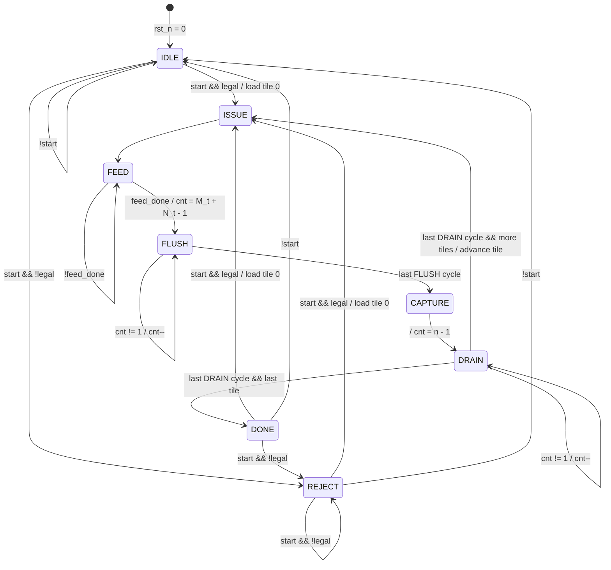

# `tile_ctrl` — control FSM contract (v1)

Status: **draft for review**. Nothing in this document is implemented yet.

All timing below is derived from the RTL as of commit `8b0dcb7` (pe, pe_grid,
read_sequencer, skew_buffer, feeder) and was cross-checked against
`FeederModel`. No existing module is changed by this contract.

---

## 1. Scope

`tile_ctrl` sequences one matmul job `C[M×N] = A[M×K] · B[K×N]` over a square
`ARRAY_DIM × ARRAY_DIM` grid by tiling the output. It emits **control signals
only**:

- when the feeder starts a tile, and with which per-tile dims;
- which output tile is in flight (a tile *identifier*, not an address);
- when the grid captures accumulators into the shadow registers, and when it shifts them out.

It never touches operand or result data, never computes memory addresses and
never generates `valid` / `first` bits.

### What it deliberately does **not** own (already owned upstream)

| Concern | Owner |
|---|---|
| k loop counter, `rd_en`, `rd_col_a` / `rd_row_b` (= k) | `read_sequencer` |
| 1-cycle operand-buffer latency alignment | `read_sequencer` |
| Per-lane `valid` (lane < M, lane < N): edge-tile inactivity | `read_sequencer` |
| `first` on k = 0 (clears the accumulators, no extra cycle) | `read_sequencer` → rides with A payload → `pe` |
| Operand skew | `skew_buffer` |
| Multiply-accumulate, hold on `in_valid = 0` | `pe` |

Because accumulator clearing is done by `first`, there is **no CLEAR/INIT
state**. Because the k loop lives in `read_sequencer`, the FSM learns that the
feed has ended from `feed_done` rather than by counting K itself.

## 2. Tiling decision

Tiling is over **M and N only**. Each output tile is `M_t × N_t` with
`M_t = min(n, M − tile_m·n)` and `N_t = min(n, N − tile_n·n)`. K streams
through every tile in full (`1 ≤ K ≤ MAX_K`).

Agreed: this is the right v1 choice, and the existing hardware forces it anyway.
`read_sequencer` unconditionally asserts `first` on k = 0, so every pass
overwrites the accumulators. K-tiling (accumulating partial sums across passes)
would need either a "suppress first" input on the feeder or a partial-sum
preload path into the PEs. Both are upstream changes, so K-tiling is listed
under Known simplifications.

Tile order is **row-major over tiles**: `tile_n` is the inner loop and `tile_m`
the outer loop.

## 3. Parameters, clocking, reset

| Name | Source | Default | Meaning |
|---|---|---|---|
| `ARRAY_DIM` (n) | `pe_pkg` | 4 (Makefiles use 5) | Grid is n × n. **Must be ≥ 2** (see §9) |
| `MAX_K` | `pe_pkg` | 1024 | Largest legal K |
| `K_W` | `pe_pkg` | `$clog2(MAX_K+1)` | Width of K |
| `DIM_W` | `pe_pkg` | `$clog2(n+1)` | Width of per-tile dims (feeder M/N) |
| `MAX_M` | `tile_ctrl` module parameter | 64 | Largest legal job M |
| `MAX_N` | `tile_ctrl` module parameter | 64 | Largest legal job N |
| `M_W` | localparam | `$clog2(MAX_M+1)` | Width of job M |
| `N_W` | localparam | `$clog2(MAX_N+1)` | Width of job N |
| `TILES_M` | localparam | `ceil(MAX_M / n)` | Max tile rows |
| `TILES_N` | localparam | `ceil(MAX_N / n)` | Max tile cols |
| `TM_W` / `TN_W` | localparam | `max(1, $clog2(TILES_M))` / same for N | Tile-index widths |

`MAX_M` / `MAX_N` are module parameters (set with `-G` from the Makefile), not
`pe_pkg` defines, so that `pe_pkg.sv` stays untouched (open question Q2).
The defaults are deliberately **not** of the form 2^x − 1, so out-of-range dims
are representable on the input ports and the range check is not vacuous.

- Single clock `clk`, all state updates on `posedge clk`.
- `rst_n`: **asynchronous, active-low**, matching `pe` and `read_sequencer`.
  (`skew_buffer` uses a synchronous reset; that inconsistency is reported
  upstream and not copied.)
- Reset state: `IDLE`, all counters 0, every output 0.

## 4. Port list

Timing notation: "post-edge e" means the value visible after rising edge e.
"Sampled at edge e" means the value the receiver registers on edge e.

### 4.1 Command interface

| Port | Dir | Width | Timing / contract |
|---|---|---|---|
| `clk` | in | 1 | |
| `rst_n` | in | 1 | async, active-low |
| `start` | in | 1 | Sampled on an edge where `busy = 0` (state IDLE, DONE or REJECT). **Ignored while `busy = 1`**, same rule as `feeder.start` |
| `M` | in | `M_W` | Sampled only on an accepted `start` edge, ignored otherwise |
| `N` | in | `N_W` | as `M` |
| `K` | in | `K_W` | as `M` |
| `busy` | out | 1 | High from the cycle after an accepted legal `start` through the last DRAIN cycle |
| `done` | out | 1 | **Single-cycle pulse**, with `busy = 0`. Exactly one per accepted `start`, legal or illegal |
| `error` | out | 1 | High only together with `done`. `done & error` = command rejected, no tiles run |

### 4.2 Toward the feeder (`rtl/feeder.sv`)

| Port | Dir | Width | Drives / driven by | Timing / contract |
|---|---|---|---|---|
| `feed_start` | out | 1 | → `feeder.start` | 1-cycle pulse, once per tile, only in ISSUE |
| `feed_M` | out | `DIM_W` | → `feeder.M` | = `M_t` ∈ [1, n]. Stable from ISSUE through DRAIN of the tile |
| `feed_N` | out | `DIM_W` | → `feeder.N` | = `N_t` ∈ [1, n]. Same stability |
| `feed_K` | out | `K_W` | → `feeder.K` | = job K ∈ [1, MAX_K]. Constant for the whole job |
| `feed_done` | in | 1 | ← `feeder.done` | Expected only in FEED. Ignored in every other state |

`feeder.busy` is intentionally **not** consumed: in the serialized v1 flow the
feeder is guaranteed idle at every ISSUE (§6), so `feed_done` is enough.

### 4.3 Toward `pe_grid` (`rtl/pe_grid.sv`)

| Port | Dir | Width | Drives | Timing / contract |
|---|---|---|---|---|
| `capture` | out | 1 | → `pe_grid.capture` | 1-cycle pulse, once per tile, only in CAPTURE |
| `shift_en` | out | 1 | → `pe_grid.shift_en` | High for exactly n − 1 consecutive cycles (DRAIN), immediately after `capture`. Never high together with `capture` |

### 4.4 Toward the operand buffer (external; a testbench stub in v1)

| Port | Dir | Width | Timing / contract |
|---|---|---|---|
| `tile_m` | out | `TM_W` | Tile row index ∈ [0, ceil(M/n) − 1]. Stable from ISSUE through DRAIN |
| `tile_n` | out | `TN_W` | Tile column index ∈ [0, ceil(N/n) − 1]. Same stability |

These are identifiers, not addresses. The buffer (outside this contract) serves
`A[tile_m·n + lane][k]` on `rd_a[lane]` and `B[k][tile_n·n + lane]` on
`rd_b[lane]`. A future collector can also use them to place drained rows.

### 4.5 Output-register stability rule

`feed_M`, `feed_N`, `feed_K`, `tile_m` and `tile_n` are functions of registers
that change on **only two edges**:

1. an accepted legal `start` (load tile 0), and
2. the DRAIN → ISSUE edge (advance to the next tile).

They are **not** updated on the DRAIN → DONE edge or on REJECT, so they keep
their last values while idle. They are reset to 0. This makes them fully
deterministic, so the lockstep compare checks them every cycle.

## 5. State machine

| State | busy | done | error | feed_start | capture | shift_en | Leaves when |
|---|:-:|:-:|:-:|:-:|:-:|:-:|---|
| IDLE | 0 | 0 | 0 | 0 | 0 | 0 | `start` |
| ISSUE | 1 | 0 | 0 | **1** | 0 | 0 | always (1 cycle) |
| FEED | 1 | 0 | 0 | 0 | 0 | 0 | `feed_done` |
| FLUSH | 1 | 0 | 0 | 0 | 0 | 0 | after M_t + N_t − 1 cycles |
| CAPTURE | 1 | 0 | 0 | 0 | **1** | 0 | always (1 cycle) |
| DRAIN | 1 | 0 | 0 | 0 | 0 | **1** | after n − 1 cycles |
| DONE | 0 | **1** | 0 | 0 | 0 | 0 | always (1 cycle), behaves like IDLE on `start` |
| REJECT | 0 | **1** | **1** | 0 | 0 | 0 | always (1 cycle), behaves like IDLE on `start` |

`legal = (1 ≤ M ≤ MAX_M) && (1 ≤ N ≤ MAX_N) && (1 ≤ K ≤ MAX_K)`



(The exact counter encoding, whether it counts down to 0 or to 1, is an
implementation detail. The contract is the number of cycles spent in each state.)

**Tile advance** (on the DRAIN → ISSUE edge). The FSM keeps `m_rem`, `n_rem` as
the rows/cols remaining including the current tile, so the per-tile dims are a
compare, not a multiply:

```
M_t = (m_rem > n) ? n : m_rem          N_t = (n_rem > n) ? n : n_rem
if (n_rem > n)      { tile_n++; n_rem -= n; }                          -> ISSUE
else if (m_rem > n) { tile_m++; m_rem -= n; tile_n = 0; n_rem = N_h; } -> ISSUE
else                                                                    -> DONE
```

On load (accepted legal `start`): `tile_m = tile_n = 0`, `m_rem = M`,
`n_rem = N`, `N_h = N`, `K_h = K`.

**Illegal state encodings.** 8 states need 3 bits, and all 8 codes are used.
The `default` branch of the next-state `case` still goes to IDLE with all
outputs at their defaults, as a defined recovery if a synthesis tool re-encodes
the states (for example one-hot) and an upset produces an unused code.

## 6. Cycle-accurate timing

### 6.1 One tile

Tile-relative cycle τ (post-edge index): τ = 0 is the ISSUE cycle, and the
feeder samples `start` on the edge into τ = 1. With per-tile dims M_t, N_t and
grid size n:

| τ | FSM state | Outputs | Feeder / grid (from Phase 0) |
|---|---|---|---|
| 0 | ISSUE | `feed_start` | |
| 1 … K | FEED | | feeder `busy`, `rd_en`. Payload k leaves feeder lane i at τ = k + 3 + i |
| K + 1 | FEED | | feeder `done` (last payload entered the skew buffer) |
| K + 2 … K + M_t + N_t | FLUSH (M_t + N_t − 1 cycles) | | operands still propagating through the skew buffer and grid |
| K + M_t + N_t + 1 | CAPTURE | `capture` | **PE(M_t−1, N_t−1) acc becomes final in exactly this cycle.** `capture` is sampled at the end of it, with zero slack |
| K + M_t + N_t + 2 … K + M_t + N_t + n | DRAIN (n − 1 cycles) | `shift_en` | `drain_out` shows grid row n−1−r at τ_c + r, where τ_c = K + M_t + N_t + 2 |
| K + M_t + N_t + n + 1 | next ISSUE or DONE | | `drain_out` shows row 0 (sampled by a future collector at the end of this cycle) |

**Cycles per tile:**

```
T_tile(M_t, N_t) = 1 (ISSUE) + (K + 1) (FEED) + (M_t + N_t − 1) (FLUSH) + 1 (CAPTURE) + (n − 1) (DRAIN)
                 = K + M_t + N_t + n + 1
```

Why FLUSH is M_t + N_t − 1: PE(i, j) does its k-th MAC on the edge into
τ = k + 4 + i + j, so its accumulator is final from τ = K + 3 + i + j. The last
active PE (M_t − 1, N_t − 1) is final at τ = K + M_t + N_t + 1, which is the
CAPTURE cycle. Earlier would capture a stale accumulator. Later is legal but
wastes cycles, and the property checks require the exact cycle.

Why the feeder is idle at every ISSUE: the feeder's `busy` is already low from
τ = K + 1, and the next ISSUE is ≥ M_t + N_t + n cycles later.

**Worked example** (n = 4, K = 3, M_t = 2, N_t = 3, so T_tile = 13):

```
τ        0   1   2   3   4   5   6   7   8   9  10  11  12 | 13
state  ISS FED FED FED FED FLS FLS FLS FLS CAP DRN DRN DRN | ISS/DONE
feed_st  1   .   .   .   .   .   .   .   .   .   .   .   . |
fdr_busy .   1   1   1   .   .   .   .   .   .   .   .   . |
feed_dn  .   .   .   .   1   .   .   .   .   .   .   .   . |
capture  .   .   .   .   .   .   .   .   .   1   .   .   . |
shift_en .   .   .   .   .   .   .   .   .   .   1   1   1 |
drain_out row:                                   3   2   1 |  0
```

### 6.2 Multi-tile job

Job-relative cycle t: t = 0 is the cycle after the accepted `start` edge
(tile 0's ISSUE). Tiles run back-to-back with no gap: tile i+1's ISSUE is the
cycle after tile i's last DRAIN cycle.

With `T_m = ceil(M/n)` and `T_n = ceil(N/n)`:

```
L = Σ_tiles T_tile = T_m·T_n·(K + n + 1) + T_n·M + T_m·N
```

(Σ M_t over a tile column is M, and every tile row repeats it T_n times. The
same argument applies to N.)

- `busy` is high for t = 0 … L − 1.
- `done` is high at t = L (exactly one cycle).
- The earliest next `start` is driven during t = L and sampled at the end of it.
- A rejected command gives `done & error` at t = 0, and `busy` never rises.

Worked example (n = 4, M = 6, N = 5, K = 3, so T_m = T_n = 2):

| tile (m, n) | M_t × N_t | T_tile | starts at t |
|---|---|---|---|
| (0, 0) | 4 × 4 | 16 | 0 |
| (0, 1) | 4 × 1 | 13 | 16 |
| (1, 0) | 2 × 4 | 14 | 29 |
| (1, 1) | 2 × 1 | 11 | 43 |

L = 54 = 4·8 + 2·6 + 2·5, so `done` is high at t = 54.

Both formulas were checked in a scratch script against `FeederModel` for
n ∈ {2, 4, 5}, K ∈ {1, 3, 7} and every M_t, N_t ∈ [1, n] (capture cycle), and
for M, N ∈ [1, 29] (L closed form versus the per-tile sum). Phase 2's pure
schedule helper will encode the same formulas independently of the state machine.

## 7. Partial edge tiles

When M or N is not a multiple of n, the last tile row and/or column has
M_t < n or N_t < n. The FSM's only job is to put `M_t` / `N_t` on
`feed_M` / `feed_N`. Inactivity then emerges exactly as it does today:
`read_sequencer` drives `valid = 0` on A lanes ≥ M_t and B lanes ≥ N_t, so
PE(i, j) with i ≥ M_t **or** j ≥ N_t never sees `in_valid` and never MACs.

Consequences that are part of the contract:

- FLUSH shrinks with the tile (M_t + N_t − 1), so edge tiles are shorter.
- DRAIN does **not** shrink: drain is bottom-up and the active rows are at the
  top, so all n − 1 shifts are always needed.
- Inactive PEs **hold** their previous accumulator (`pe` holds on
  `in_valid = 0`), so drained rows ≥ M_t and columns ≥ N_t carry **stale values
  from an earlier tile**. A consumer must mask to M_t × N_t. The FSM does not
  zero them; that would be a datapath action.

## 8. Illegal and degenerate inputs

| Situation | Behaviour |
|---|---|
| `start` with M = 0, N = 0 or K = 0 | REJECT: `done & error` for one cycle, no feeder activity, `busy` stays 0. (K = 0 must never reach the feeder: `read_sequencer` hangs with `busy` stuck high, reported upstream) |
| `start` with M > MAX_M, N > MAX_N or K > MAX_K | REJECT, same as above |
| `start` while `busy` | Ignored silently: no error, the in-flight job is unaffected, and M/N/K are not sampled. Matches `feeder.start` |
| `start` held high for many cycles | One job per edge on which `busy = 0`. A `start` still high in the DONE cycle launches a new job (DONE behaves like IDLE). Hosts should pulse `start` |
| `start` in DONE or REJECT | Accepted like IDLE (`busy` is 0 there) |
| `feed_done` outside FEED | Ignored by the FSM (flagged by the integration monitor) |
| `rst_n` low mid-job | Asynchronously back to IDLE, every output 0, job abandoned, no `done`. The feeder and grid share `rst_n` in integration |
| M ≤ n and N ≤ n | Single tile, the same path as multi-tile (no special case) |

## 9. Properties (the spec for the Phase 3 monitors and Phase 5 SVA)

1. `busy == (state ∈ {ISSUE, FEED, FLUSH, CAPTURE, DRAIN})`.
2. Every accepted `start` produces exactly one `done` cycle, never with `busy`. `done` is high on two consecutive cycles only when the second cycle answers a new command sampled in the first one (a `start` in DONE or REJECT that is itself rejected). Otherwise it is a single-cycle pulse.
3. `error → done`.
4. `feed_start`, `capture` and `shift_en` are 0 whenever `busy = 0`. `capture & shift_en` is never true.
5. Per job: `feed_start` count = `capture` count = T_m·T_n, and `shift_en` cycles = T_m·T_n·(n − 1).
6. Per tile: `capture` comes exactly K + M_t + N_t + 1 cycles after `feed_start`, `shift_en` is high for exactly the n − 1 cycles right after `capture`, and the next `feed_start` (or `done`) is exactly T_tile cycles after this one.
7. `tile_m < ceil(M/n)` and `tile_n < ceil(N/n)` always. Tiles are visited row-major, each exactly once.
8. `feed_M = min(n, M − tile_m·n)` ∈ [1, n] and `feed_N = min(n, N − tile_n·n)` ∈ [1, n] at every `feed_start`. `feed_K = K`.
9. `feed_M`, `feed_N`, `feed_K`, `tile_m` and `tile_n` change only on the two edges in §4.5.
10. Job latency (accepted `start` edge → `done`) = L from §6.2. Rejected commands have latency 1.
11. `feed_done` is observed only in FEED (integration only).

## 10. Files (planned)

| File | Phase |
|---|---|
| `docs/fsm_contract.md` (this file) | 1 |
| `tb/tile_ctrl/tile_ctrl_model.py`: `TileCtrlModel` (cycle-steppable, `step()` returns post-edge outputs, like `FeederModel`) plus a pure `tile_schedule(M, N, K, n)` helper | 2 |
| `tb/tile_ctrl/test_tile_ctrl_model.py`: plain pytest for the model | 2 |
| `tb/tile_ctrl/test_tile_ctrl.py` and `tb/tile_ctrl/Makefile`: cocotb, same structure as `tb/feeder/` | 3 |
| `rtl/tile_ctrl.sv` | 3 (stub) → 4 |
| `tb/tile_ctrl_integration/`: feeder + pe_grid + tile_ctrl smoke test (needs a small wrapper, since the existing modules are unchanged) | 5 |

## 11. Known simplifications

1. **No K-tiling.** K ≤ MAX_K streams through each tile in one pass, because `read_sequencer` always asserts `first` on k = 0 (§2).
2. **Fully serialized tiles.** The next tile's ISSUE waits until the previous DRAIN finishes. The shadow-register double buffer would allow capture/drain of tile i to overlap the feed of tile i+1, but v1 does not use it. Cost per tile: about M_t + N_t + n cycles of idle MACs.
3. **No valid/ready handshake.** The FSM assumes the operand buffer always returns data 1 cycle after `rd_en`, and that whatever consumes `drain_out` is always ready. No backpressure, no stall.
4. **No operand double buffering / ping-pong**, and no operand reuse: each A row-tile is re-read T_n times and each B column-tile T_m times.
5. **Square grid only.** No rectangular n_a × n_b split.
6. **DRAIN is always n − 1 shifts**, even for edge tiles (bottom-up drain).
7. **Stale data outside M_t × N_t on `drain_out`** for edge tiles. Masking is the consumer's job (§7).
8. **No drain-row-valid signal.** Drain timing is fully determined by `capture` (§6.1), and no collector exists yet to consume such a signal.
9. **No watchdog on `feed_done`.** If the feeder never reports done, the FSM waits in FEED until reset.
10. **`error` is a pulse, not a sticky status register.** It does not say *which* dimension was illegal.
11. **`ARRAY_DIM ≥ 2` and `MAX_M, MAX_N ≥ ARRAY_DIM` are required.** DRAIN has n − 1 ≥ 1 cycles, and a job limit must hold at least one full tile so `ARRAY_DIM` fits the M/N port widths. Both are enforced by elaboration-time `$error` checks in `tile_ctrl.sv`.
12. **`MAX_M` / `MAX_N` are `tile_ctrl` module parameters**, not `pe_pkg` defines.
13. **The cocotb suite only covers part of the parameter space.** It needs `MAX_M, MAX_N ≥ 3·ARRAY_DIM + 1` and `MAX_K ≥ ARRAY_DIM + 1`, because the directed shapes must be drivable on the ports. Smaller limits are refused with a clear message rather than tested. When a `MAX_*` is 2^W − 1 its over-limit value cannot be driven at all, so those commands are skipped and the `reject_over_limit` coverage item is waived only if *every* limit is 2^W − 1.
14. **The RTL assertions do not cover reset or X.** They are disabled while reset is asserted (gated by a checker-only, async-reset `sva_armed` flop), so async-reset behaviour is checked only by the cocotb `ProtocolMonitor` and `Env.reset`. Verilator is 2-state, so there are no `$isunknown` checks; the cocotb snapshot rejects X/Z on every port instead. §9.11 is a system property, checked in `tb/tile_ctrl_integration/`.
15. **The integration test is a smoke test, not a product top.** `tile_ctrl_integration_top.sv` lives under `tb/`, the operand buffer and drain collector are Python stand-ins, and it runs at a single configuration (ARRAY_DIM = 4).

## 12. Open questions (deferred, not blocking v1)

- **Q1. Overlap.** Should v2 overlap capture/drain with the next tile's feed? The legal window for `capture` is [K + M_t + N_t + 1, next start + 3] in feeder-relative edges (Phase 0), which would bring the tile period down to about max(K + 1, K + M_t + N_t − 2, n) plus ISSUE. That needs drain to run as a second concurrent sequencer.
- **Q2. Parameter home.** Move `MAX_M` / `MAX_N` into `pe_pkg` alongside `MAX_K` once modifying the package is acceptable?
- **Q3. Collector interface.** Should the FSM emit a drain-row index / valid, or should the collector derive it from `capture` plus `tile_m` / `tile_n` / `feed_M` / `feed_N`? Decide when the collector is designed.
- **Q4. Tile order.** Row-major (current) versus column-major only matters once operand reuse or buffering exists.
- **Q5. Error reporting.** Sticky status or cause code instead of a pulse?
- **Q6. Feeder `busy`.** Should the FSM also check `feeder.busy == 0` before ISSUE as a defensive measure? Under this contract it is redundant.
- **Q7. Mixed reset styles upstream** (`skew_buffer` sync versus the rest async). This doesn't affect the FSM, but the integration test inherits it.
